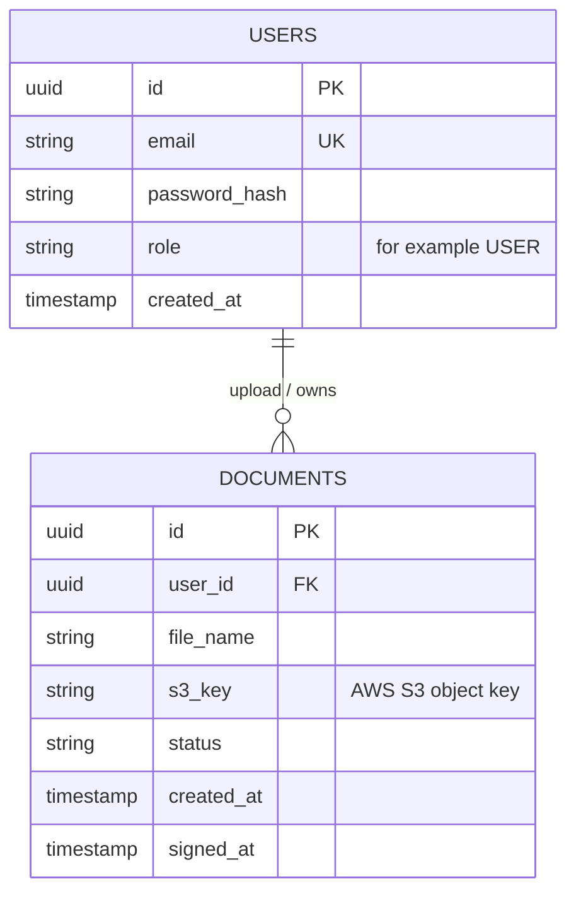
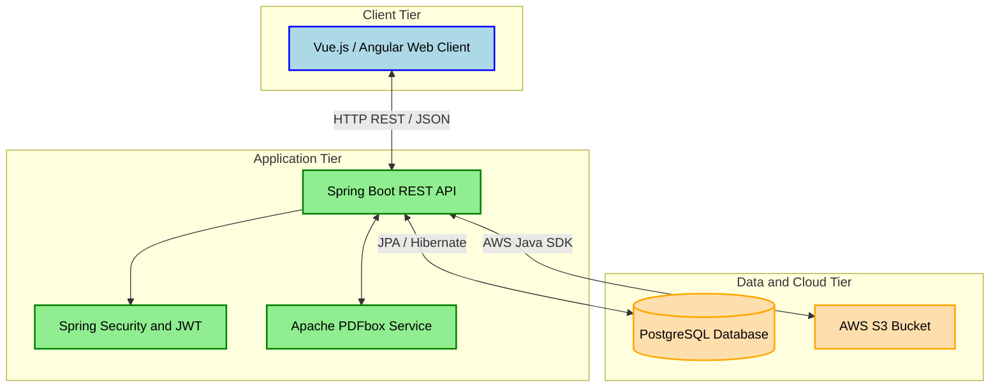

# SignFlow - Secure PDF Watermarking & Storage System

## 1. Project Brief (Executive Summary)
SignFlow is a full-stack, cloud-integrated web application designed to help users securely upload, manage, and digitally watermark PDF documents. The system solves the problem of manual document stamping by providing an automated, secure, and scalable cloud-based solution. Users can register, manage their documents via a dashboard, and apply a permanent, visual signature/watermark to their PDFs with a single click.

## 2. Core Features (Functional Requirements)
* **User Authentication:** Secure registration and login system. Only authenticated users can access the platform and view their own documents.
* **Document Management Dashboard:** A user interface to list all uploaded documents, displaying their current status (`PENDING` or `SIGNED`), upload date, and file name.
* **Cloud File Upload:** Users can upload PDF files via the frontend. The application securely transfers and stores these physical files in the cloud (AWS S3), saving only the file metadata in the relational database.
* **Automated PDF Watermarking:** Upon triggering the "Sign" action, the system retrieves the file from the cloud, applies a customized visual watermark onto the PDF pages, and securely overwrites/saves the finalized document back to the cloud.

## 3. Technical Constraints & Architecture Goals
* **Backend:** Built with Java and Spring Boot (REST API architecture).
* **Frontend:** Single Page Application (SPA) built with Vue.js / Angular.
* **Database:** PostgreSQL for relational data mapping, running in an isolated Docker container.
* **Cloud Infrastructure:** Amazon Web Services (AWS) S3 for scalable object storage.
* **Security:** JWT (JSON Web Tokens) for stateless API authentication, hashed passwords, and secure cloud credentials management.

### Entity-Relationship Diagram


### Architecture Diagram

I chose a Layered architecture for this project. This will help me separate the concerns as well as help me easily implement changes, for example, to the UI. Although this approach might make the layers hard to scale, since it only implements one overarching feature, I tought it best to stick with a more straightfoward approach.

## Layerd Architecture Diagram for the project:


### REST API Endpoints

The applications exposes a RESTful API. ALL endpoints are prefixed with "/api/v1". Endpoints interacting with documents will require a valid JWT token passed in the "Authorization" header as a Bearer token.

## 1. Authentication - Public Endpoints:

| HTTP Method | Endpoint | Description | Expected Payload | Response |
| :--- | :--- | :--- | :--- | :--- |
| **POST** | '/auth/register' | Registers a new user | '{"email": "test@test.com","password": "..."}' | '201 Created' |
| **POST** | '/auth/login' | Authenticates a user and returns a JWT. | '{"email": "test@test.com","password": "..."}' | '200 OK (returns token)' |

**Example Login Response:**
```json
{
  "token": "tokentokentokentokentokentokentokentoken....",
  "type": "Bearer",
  "expires_in": 3600
}
```
## 2. Document Management - Protected Endpoints
| HTTP Method | Endpoint | Description | Expected Payload | Response |
| :--- | :--- | :--- | :--- | :--- |
| **GET** | '/documents' | Retrieves all documents owned by the user. | *None* | '200 OK (Array of documents)' |
| **GET** | '/documents/{id}' | Retrieves data for a specififc doc. | *None* | '200 OK (doc object)' |
| **GET** | '/documents/{id}/download' | Downloads the actual PDF file | *None* | '200 OK (pdf)' |
| **POST** | '/documents' | Upload a new PDF file to AWS S3 | 'Multipart/form-data' (file) | '201 Created' |
| **POST** | '/documents/{id}/sign' |Triggers the watermarking process on a specific pdf | *None* | '200 OK ' |
| **DELETE** | '/documents/{id}' |Deletes a specific document data and removes the file from S3 | *None* | '204 No Content' |

**Example GET '/documents/{id}' Response:**
```json
{
  "id": "idididididididididid",
  "fileName": "example.pdf",
  "status": "SIGNED",
  "createdAt": "2026-06-...",
  "signedAt": "2026-06-..."
}
```

## 3. User and token managemant Endpoints

| HTTP Method | Endpoint | Description | Expected Payload | Response |
| :--- | :--- | :--- | :--- | :--- |
| **GET** | '/users/me' | Retrieves all profiledata of the currently authenticated user. | *None* | '200 OK (user object)' |
| **PATCH** | '/documents/{id}' | Renames a document's display name | '{"fileName": "new_name.pdf}' | '200 OK' |
| **GET** | '/health' | Application "heath" check for Docker/AWS load balancers | *None* | '200 OK' '{"status": "Up" }'|


## 4. DevOps and Deployment Architecture

The application is fully containerized and designed to run in modern cloud-native environments (Kubernetes), ensuring high availability, automated scaling, and robust monitoring.

### Infrastructure & Deployment Stack
* **Containerization:** Multi-stage 'Dockerfile' implementation optimizing final image sizes for the Spring Boot backend.
* **Kubernetes K8s:** Declarative deployments 'deployment.yaml' and services managing backend pods, secure environment variables via **Secrets**, and persistent database connectivity.
* **Infrastructure as Code (Terraform):** Manages cloud resource integration such as AWS S3 storage buckets cleanly through state configurations.
* **Monitoring & Observability:** Integrated **Spring Boot Actuator** exposing metrics through '/actuator/prometheus' and '/actuator/health', scraped automatically via Kubernetes annotations by monitoring systems.

### Quick DevOps Commands Reference

* **Build Docker Image:**
  ```bash
  docker build -t signflow-backend:latest .
