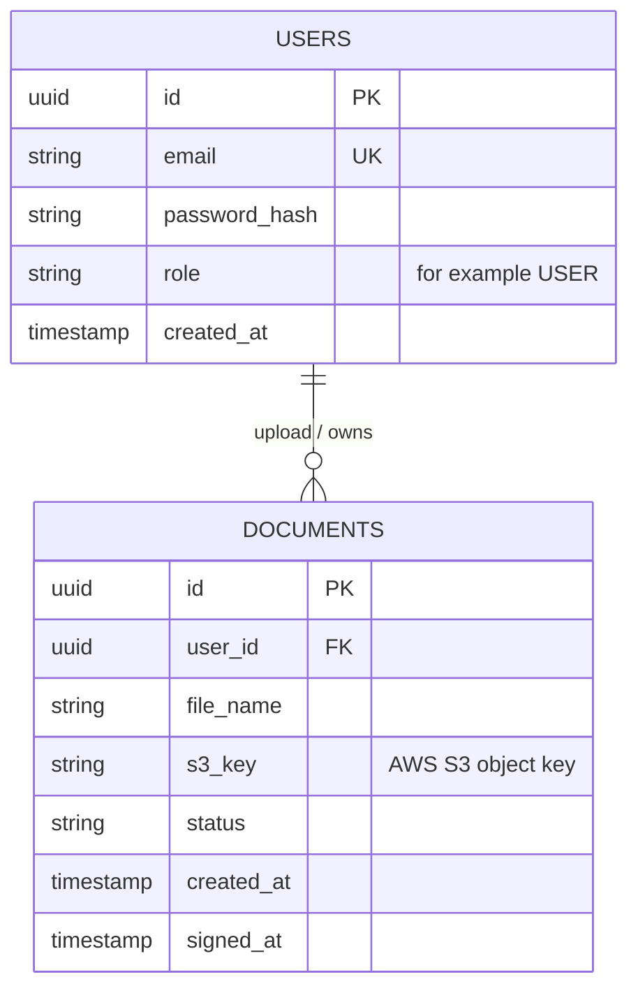
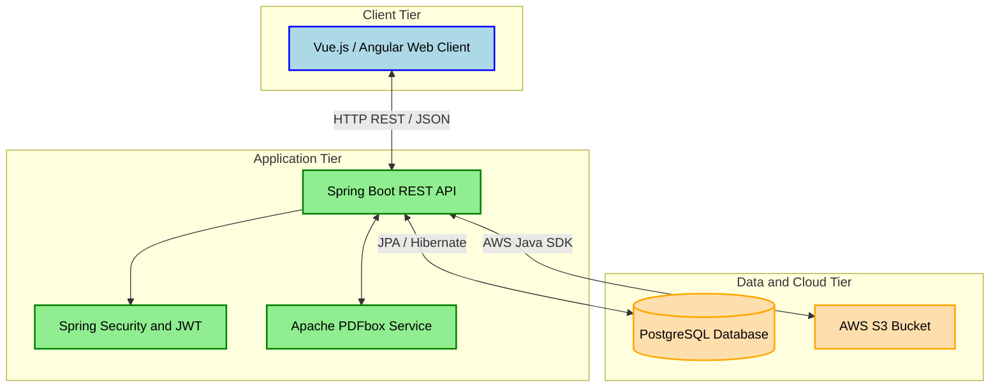

# VeriDoc_Project_BackEnd
PDF Signing app BackEnd

# SignFlow - Secure PDF Watermarking & Storage System

## 1. Project Brief (Executive Summary)
SignFlow is a full-stack, cloud-integrated web application designed to help users securely upload, manage, and digitally watermark PDF documents. The system solves the problem of manual document stamping by providing an automated, secure, and scalable cloud-based solution. Users can register, manage their documents via a dashboard, and apply a permanent, visual signature/watermark to their PDFs with a single click.

## 2. Core Features (Functional Requirements)
* **User Authentication:** Secure registration and login system. Only authenticated users can access the platform and view their own documents.
* **Document Management Dashboard:** A user interface to list all uploaded documents, displaying their current status (`PENDING` or `SIGNED`), upload date, and file name.
* **Cloud File Upload:** Users can upload PDF files via the frontend. The application securely transfers and stores these physical files in the cloud (AWS S3), saving only the file metadata in the relational database.
* **Automated PDF Watermarking:** Upon triggering the "Sign" action, the system retrieves the file from the cloud, applies a customized visual watermark onto the PDF pages, and securely overwrites/saves the finalized document back to the cloud.

## 3. Technical Constraints & Architecture Goals
* **Backend:** Built with Java and Spring Boot (REST API architecture).
* **Frontend:** Single Page Application (SPA) built with Vue.js / Angular.
* **Database:** PostgreSQL for relational data mapping, running in an isolated Docker container.
* **Cloud Infrastructure:** Amazon Web Services (AWS) S3 for scalable object storage.
* **Security:** JWT (JSON Web Tokens) for stateless API authentication, hashed passwords, and secure cloud credentials management.

### Entity-Relationship Diagram

### Architecture Diagram

I chose a Layered architecture for this project. This will help me separate the concerns as well as help me easily implement changes, for example, to the UI. Although this approach might make the layers hard to scale, since it only implements one overarching feature, I tought it best to stick with a more straightfoward approach.

## Layerd Architecture Diagram for the project:

